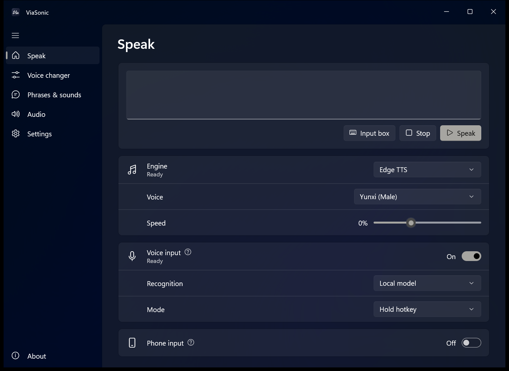
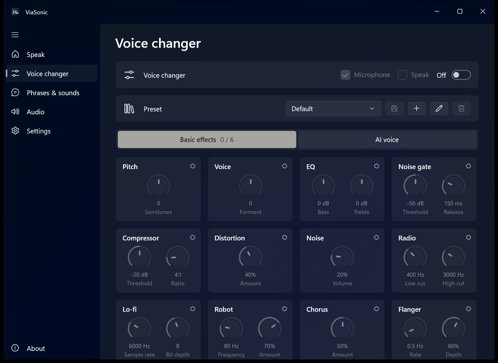
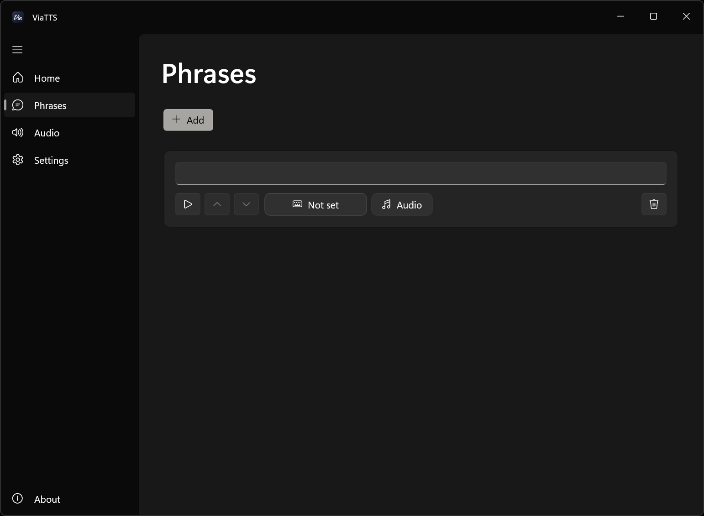
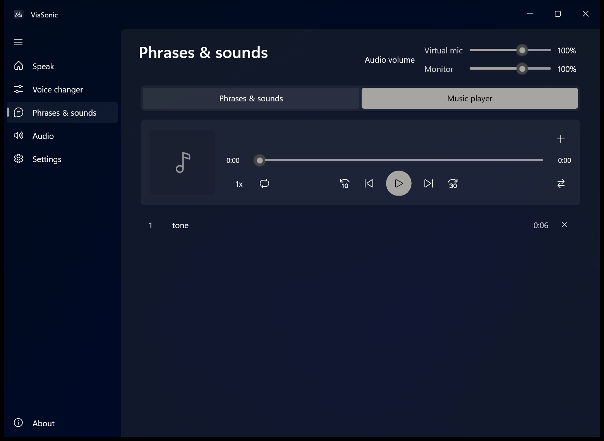
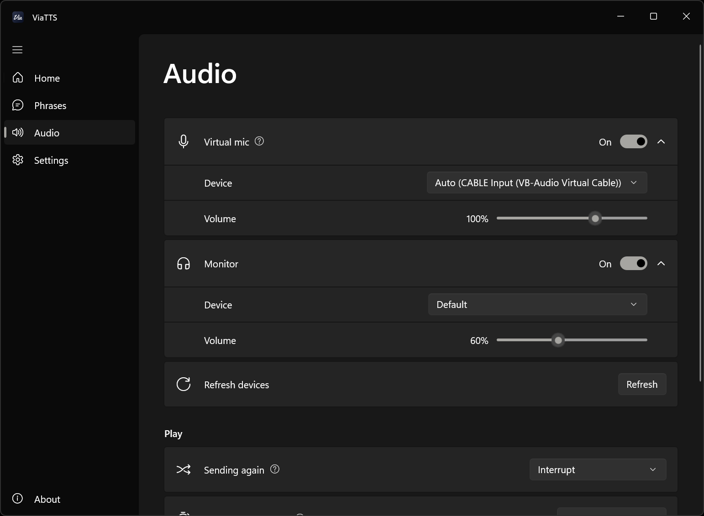
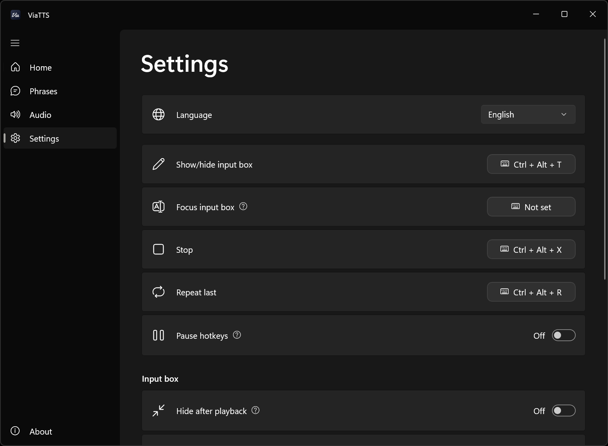

<div align="center">


# ViaSonic

Real-time text-to-speech, a voice changer (with RVC), phrases and sounds, and a music player. Sound goes out through a virtual microphone.

[](https://github.com/wlsnD7/ViaSonic/releases/latest)
[](LICENSE)


[Install](#install) | [In-game setup](#in-game-setup) | [Hotkeys](#default-hotkeys) | [Development](#development)

[简体中文](README.md) | English

<table>
  <tr>
    <td></td>
    <td></td>
  </tr>
  <tr>
    <td></td>
    <td></td>
  </tr>
  <tr>
    <td></td>
    <td></td>
  </tr>
</table>

</div>

## Install

- Download `ViaSonic_<version>_setup.exe` from [Releases](https://github.com/wlsnD7/ViaSonic/releases/latest).
- Works on Windows 10 version 19041 or later, and Windows 11.
- Before using it, read the FAQ and disclaimer on the About page in the app.

## Voice engines

| Engine | Notes |
|---|---|
| Edge TTS | Free, needs internet, many voices. |
| System voice | Built into Windows, works offline. |
| GPT-SoVITS (optional) | Add any GPT-SoVITS model (GPT weights + SoVITS weights + reference audio); the version is detected automatically. Needs an NVIDIA GPU and the GPT-SoVITS package. |
| Azure Speech | Microsoft's official speech service. More voices than Edge, with speaking styles. Needs an API key; 500K characters free per month. |
| Fish Audio | Lots of community character voices, plus the models you created yourself (including cloned ones). Needs an API key. |
| Doubao Speech | Volcengine's speech synthesis, with Voice Clone 2.0 (clone in the console, then add the voice ID). Needs an API key, and the model must be enabled in the console. |
| Alibaba Model Studio | Qwen3-TTS and CosyVoice. You can add cloned CosyVoice voices. Needs an API key. |
| MiniMax | Supports cloned voices. Needs an API key. |
| iFLYTEK | iFLYTEK Open Platform's online speech synthesis. Needs an APPID, API key and API secret; add voices in the iFLYTEK console first. |
| Custom API | Connects to any HTTP API that returns audio, such as GPT-SoVITS, IndexTTS or CosyVoice running locally. |

API keys (and the iFLYTEK API secret) are stored encrypted on this PC and can only be read by the current Windows user. With paid online engines, phrases are synthesized the first time you use them and cached after that.

Download the GPT-SoVITS package from [lj1995/GPT-SoVITS-windows-package](https://huggingface.co/lj1995/GPT-SoVITS-windows-package/tree/main): choose `GPT-SoVITS-v2pro-20250604-nvidia50.7z` for RTX 50 series, or `GPT-SoVITS-v2pro-20250604.7z` for other NVIDIA GPUs (about 9 GB). To use it, choose GPT-SoVITS as the engine on the Speak page, click ⚙ next to Engine and set the package location in GPT-SoVITS folder, then click + next to Model to add a model.

## Voice changer

Turn on the voice changer on the Voice changer page. Basic effects can be stacked, up to 6 at once, and saved as presets.

AI voice (RVC) needs an NVIDIA GPU and the RVC package. Download it from [lj1995/VoiceConversionWebUI](https://huggingface.co/lj1995/VoiceConversionWebUI/tree/main): choose `RVC20260718Nvidia50x0.7z` for RTX 50 series, or `RVC20260718Nvidia.7z` for other NVIDIA GPUs. Extract it, then click ⚙ next to AI voice on the Voice changer page and set RVC folder. Models (.pth) in the package's `assets\weights` folder are listed automatically.

## Voice input

Turn on Voice input on the Speak page. What you say is turned into text and read in the current voice. Voice input and Mic passthrough can't be on at the same time: turning on voice input turns passthrough off, and turning voice input off brings it back.

- Mode: Hold hotkey (set "Hold for voice input" on the Hotkeys page), or Continuous detection (reads each sentence when you finish; listening pauses during playback).
- Recognition: a local model (SenseVoice, supports Chinese, English, Japanese, Korean and Cantonese, works offline; click Download on the card, about 230 MB), Azure Speech, Alibaba Model Studio, iFLYTEK, or an OpenAI-compatible speech-to-text API. Azure, Model Studio and iFLYTEK share their keys with the voice engines.

## Phone input

Turn on Phone input on the Speak page and scan the QR code with your phone. Type on your phone, hear it on your PC. Both need to be on the same network.

- The phone page can stop, repeat the last line, and play phrases with a tap. After you change phrases on your PC, reload the phone page.
- The first time you turn it on, Windows asks (UAC) to add a firewall rule. Click Yes. If you don't, the card shows "Blocked by the firewall". Click Allow to try again.
- New link makes the old link stop working. Scan the code again.

## Music player

Play music on the Music player tab of the Phrases & sounds page. It also goes out through the virtual microphone. Add files or folders, or import .m3u / .m3u8 playlists. It supports playback speed, back 10 seconds, forward 30 seconds, crossfade and three play modes. Use Audio volume at the top right of the page to set the virtual microphone and monitor volumes separately.

## In-game setup

1. Install [VB-Audio Virtual Cable](https://vb-audio.com/Cable/) or [Voicemeeter](https://vb-audio.com/Voicemeeter/). The app tells you if neither is installed.
2. In your game or voice app (Discord, TeamSpeak, etc.), **set the microphone to `CABLE Output`**. With Voicemeeter, choose `Voicemeeter Out B1` and turn on B1 for the `Voicemeeter Input` strip in Voicemeeter.
3. The Audio page outputs to `CABLE Input` by default, and also plays to your headphones so you can hear it.
4. To send your microphone along with the speech, turn on Mic passthrough on the Audio page and choose your microphone.
5. To let teammates hear music or video, turn on App audio on the Audio page and add those apps.
6. If the game uses push to talk, go to Push to talk on the Audio page, click the Key button, then press the game's talk key (a single keyboard key, or the middle or side mouse button). The key is held down while speech plays. Turn it on or off on the Audio page or with a hotkey.
7. Run the game in **borderless windowed** mode. In fullscreen, opening the input box minimizes the game. Some games minimize on focus loss even in borderless mode: turn off options like "Minimize on focus loss" in the game, or use windowed mode.

## Default hotkeys

| Action | Hotkey |
|---|---|
| Show / hide input box | Ctrl + Alt + T |
| Focus input box | Not set |
| Stop | Ctrl + Alt + X |
| Repeat last | Ctrl + Alt + R |
| Turn push to talk on/off | Not set |
| Play / pause music | Not set |
| Next | Not set |
| Hold for voice input | Not set |

Closing the main window keeps ViaSonic running in the background. Right-click the tray icon to exit.

## Development

### Structure

```
ViaSonic/
├─ ui/               UI and audio (C# / WinUI 3)
├─ tests/            Unit tests (xUnit)
├─ gsv_server.py     GPT-SoVITS synthesis service
├─ rvc_server.py     RVC real-time voice conversion process
├─ installer/        Inno Setup script
├─ tools/            Development scripts (translation check)
├─ design/           Icon generation script
├─ docs/             README screenshots
├─ start.bat         Runs the app in app/
├─ start_debug.bat   Same, with the GPT-SoVITS service console
├─ app/              dotnet publish output (created by the build)
└─ dist/             Installer (created by the build)
```

### Build

Requires .NET 8 SDK and Inno Setup 6:

```
dotnet publish ui -c Release -p:Platform=x64 -o app
ISCC installer\ViaSonic.iss
```

### Tests

```
dotnet test tests/ViaSonic.Tests
python -I tools/check_lang.py
```


## License

- The code is open source under the [MIT](LICENSE) license.
- Third-party components bundled with the installer and their licenses: [THIRD_PARTY_NOTICES.md](THIRD_PARTY_NOTICES.md).
- The icon lettering uses [Yellowtail](https://fonts.google.com/specimen/Yellowtail) (Astigmatic, Apache License 2.0). 
