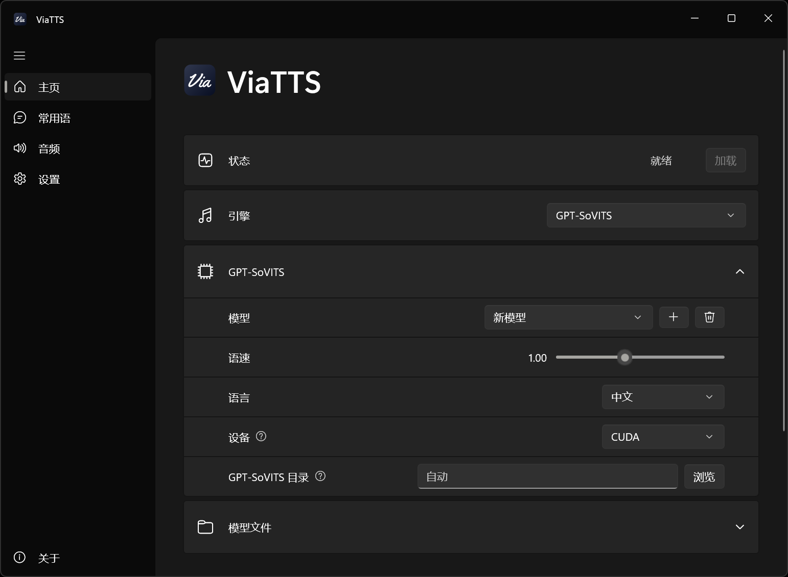

<div align="center">


# ViaTTS

游戏或语音软件内的文本转语音，通过虚拟麦克风播放生成的语音。

[](https://github.com/wlsnD7/ViaTTS/releases/latest)
[](https://github.com/wlsnD7/ViaTTS/releases)
[](LICENSE)


[下载](https://github.com/wlsnD7/ViaTTS/releases/latest) · [游戏内设置](#游戏内设置) · [快捷键](#默认快捷键) · [开发](#开发)



</div>

## 安装

- 在 [Releases](https://github.com/wlsnD7/ViaTTS/releases/latest) 页面下载安装包`ViaTTS_版本号_setup.exe`。
- Windows 10版本19041及以上和Windows 11可用。
- 使用前请阅读软件内「关于」页的常见问题和免责声明。

## 语音引擎

| 引擎 | 说明 |
|---|---|
| Edge TTS | 免费，需联网，提供多种音色。 |
| 系统语音 | Windows自带，离线。 |
| GPT-SoVITS（可选） | 可添加任意GPT-SoVITS模型（GPT权重 + SoVITS权重 + 参考音频），版本自动识别。需要Nvidia显卡和GPT-SoVITS整合包。 |

GPT-SoVITS整合包从 [lj1995/GPT-SoVITS-windows-package](https://huggingface.co/lj1995/GPT-SoVITS-windows-package/tree/main) 下载：RTX 50系选择 `GPT-SoVITS-v2pro-20250604-nvidia50.7z`，其他 Nvidia显卡选择 `GPT-SoVITS-v2pro-20250604.7z`（约9GB）。需要使用时，在软件主页「GPT-SoVITS目录」指定整合包位置（或放在ViaTTS旁边的`GPT-SoVITS`文件夹，会自动找到），在「模型」里点击加号添加模型。

## 游戏内设置

1. 安装 [VB-Audio Virtual Cable](https://vb-audio.com/Cable/)。如未安装软件内会提示。
2. 在游戏/语音软件（Discord、KOOK、Oopz等）里把**麦克风设置为 `CABLE Output`**。
3. 「音频」页默认自动输出到 `CABLE Input`，同时在耳机里监听。
4. 如果游戏用「按键说话」，在「按键说话」里填对应按键（如 `v`、`mouse4`），朗读期间会自动按住设置的按键。
5. 游戏请用**无边框窗口**模式，全屏下弹出输入框会让游戏最小化。

## 默认快捷键

| 功能 | 快捷键 |
|---|---|
| 打开 / 关闭输入框 | Ctrl + Alt + T |
| 聚焦输入框 | 未设置 |
| 停止播放 | Ctrl + Alt + X |
| 重复上一句 | Ctrl + Alt + R |

关闭主窗口软件会在后台运行，右键系统托盘图标退出。

## 开发

### 结构

```
ViaTTS/
├─ ui/              界面与音频（C#/WinUI 3）：Edge TTS、系统语音、播放、快捷键、配置
├─ gsv_server.py    GPT-SoVITS合成服务
├─ installer/       Inno Setup安装脚本
├─ app/             dotnet publish输出
└─ dist/            安装包
```

### 构建

需要.NET 8 SDK和Inno Setup 6：

```
dotnet publish ui -c Release -p:Platform=x64 -o app
ISCC installer\ViaTTS.iss
```

`start_debug.bat`会让GPT-SoVITS服务显示控制台窗口。

## 许可与授权

- 代码以 [MIT](LICENSE) 许可证开源。
- 安装包附带的第三方组件及其许可证见[THIRD_PARTY_NOTICES.md](THIRD_PARTY_NOTICES.md)。
- 图标字样使用[Yellowtail](https://fonts.google.com/specimen/Yellowtail)（Astigmatic，Apache License 2.0）。仓库里只有渲染好的图标图片，不包含字体文件；重新生成图标见`design/make_icon_final.py`。
