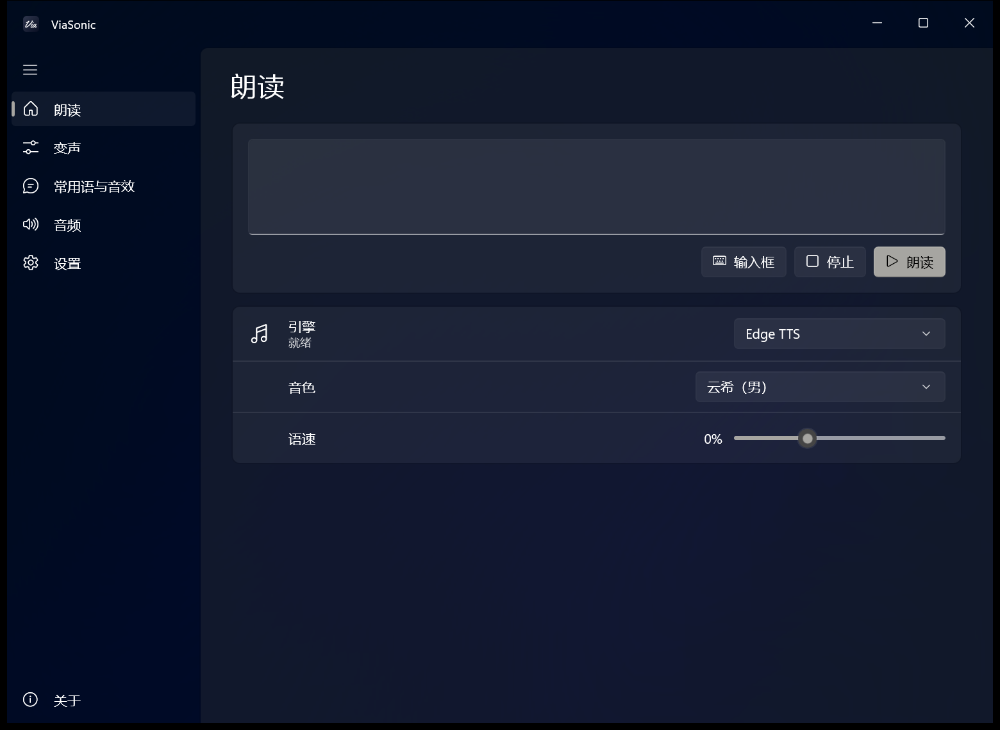
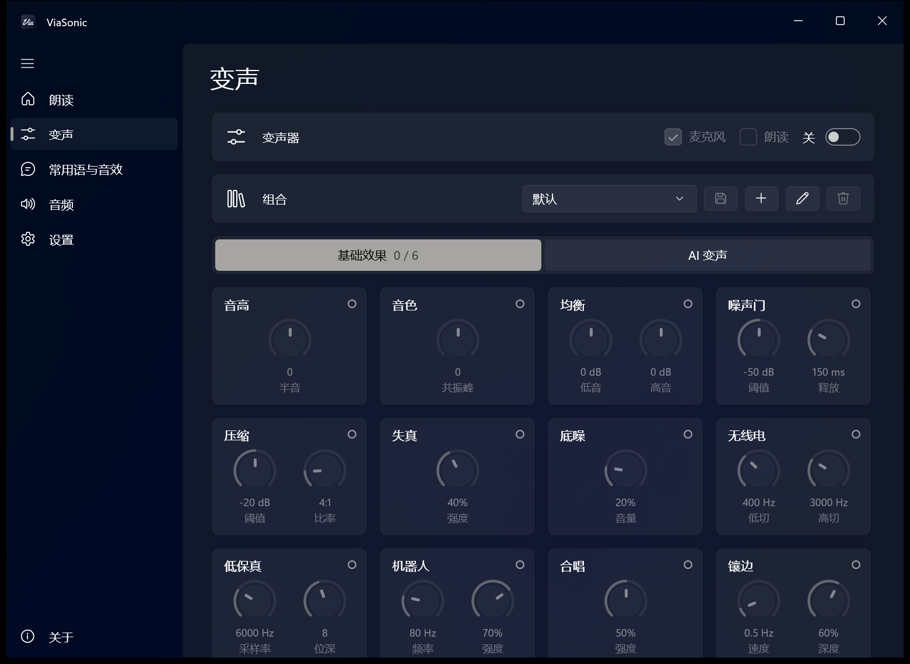
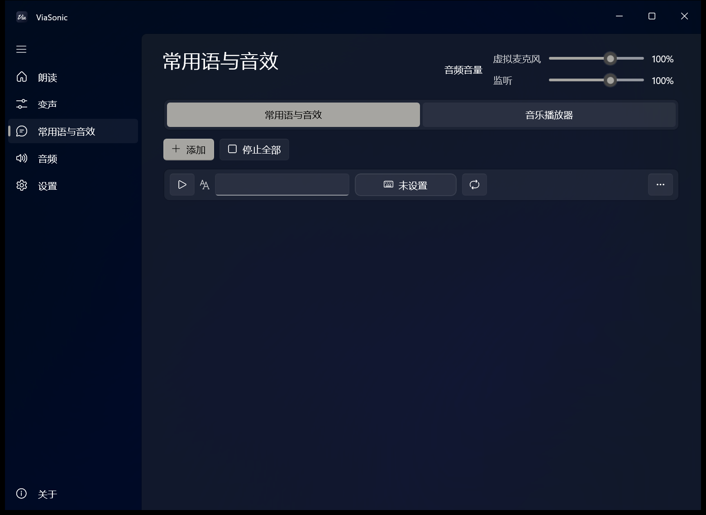
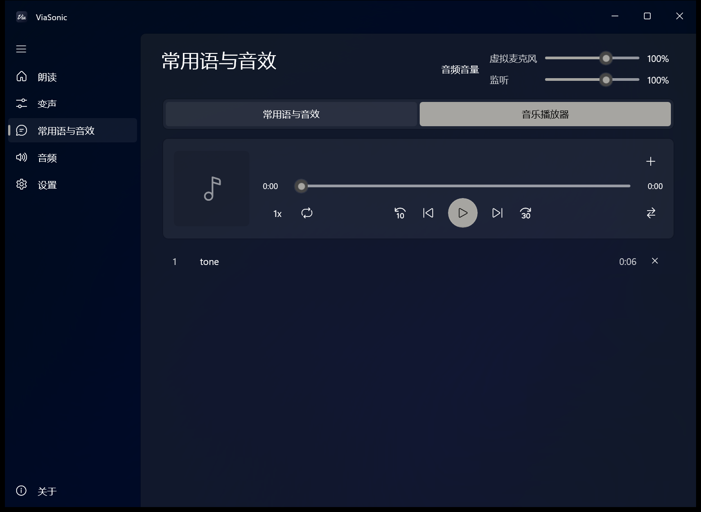
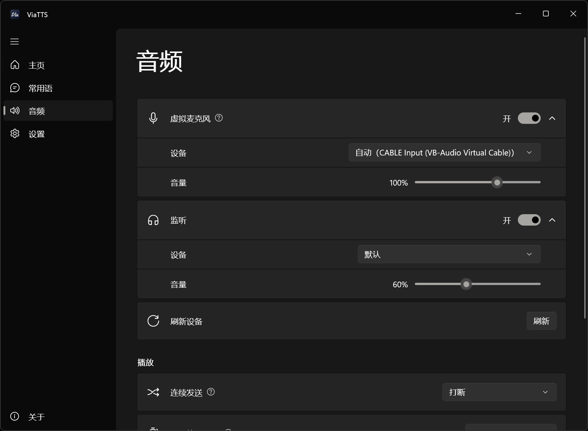
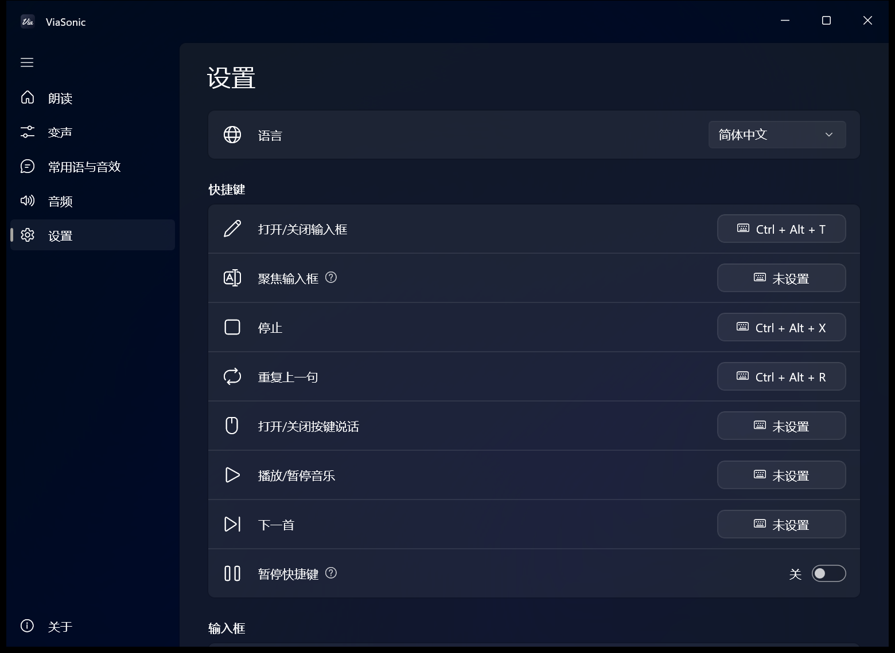

<div align="center">


# ViaSonic

实时文本转语音、变声器（含 RVC）、常用语和音效，以及音乐播放器。通过虚拟麦克风输出声音。

[](https://github.com/wlsnD7/ViaSonic/releases/latest)
[](LICENSE)


[安装](#安装) | [游戏内设置](#游戏内设置) | [快捷键](#默认快捷键) | [开发](#开发)

简体中文 | [English](README.en.md)

<table>
  <tr>
    <td></td>
    <td></td>
  </tr>
  <tr>
    <td></td>
    <td></td>
  </tr>
  <tr>
    <td></td>
    <td></td>
  </tr>
</table>

</div>

## 安装

- 在 [Releases](https://github.com/wlsnD7/ViaSonic/releases/latest) 页面下载安装包 `ViaSonic_版本号_setup.exe`。
- 支持 Windows 10（19041 及以上）和 Windows 11。
- 使用前请阅读软件内「关于」页的常见问题和免责声明。

## 语音引擎

| 引擎 | 说明 |
|---|---|
| Edge TTS | 免费，需联网，300 多个音色，先选语言再选音色。 |
| 系统语音 | Windows 自带，离线。 |
| Kokoro | 免费，离线，不需要显卡。100 个中文音色和 3 个英文音色，模型在软件里下载（约 180 MB）。 |
| GPT-SoVITS（可选） | 可添加任意 GPT-SoVITS 模型（GPT 权重 + SoVITS 权重 + 参考音频），版本自动识别。需要 NVIDIA 显卡和 GPT-SoVITS 整合包。 |
| Azure 语音 | 微软官方语音服务，音色比 Edge 更全，支持风格。需要 API Key，每月 50 万字符免费。 |
| Fish Audio | 可以使用社区里的大量角色音色，也会列出你自己创建（包括复刻）的模型。需要 API Key。 |
| 豆包语音 | 火山引擎的语音合成，支持声音复刻 2.0（在控制台复刻后添加音色 ID）。需要 API Key，并在控制台开通对应的模型。 |
| 阿里云百炼 | Qwen3-TTS 和 CosyVoice，CosyVoice 可以添加复刻音色。需要 API Key。 |
| MiniMax | 支持复刻音色，需要 API Key。 |
| 讯飞语音 | 讯飞开放平台的在线语音合成。需要 APPID、API Key 和 API Secret，音色要先在讯飞控制台添加。 |
| ElevenLabs | 多语种音色，会列出你在音色库里添加的音色。需要 API Key，免费版每月约 1 万额度，仅限非商用。Key 要开启 Text to Speech 和 Voices（读取）权限。 |
| 自定义接口 | 连接任意返回音频的 HTTP 接口，例如本地运行的 GPT-SoVITS、IndexTTS、CosyVoice。 |

API Key（以及讯飞的 API Secret）加密保存在本机，只有当前 Windows 用户能读取。联网付费引擎的常用语在第一次使用时合成，之后用缓存。

GPT-SoVITS 整合包从 [lj1995/GPT-SoVITS-windows-package](https://huggingface.co/lj1995/GPT-SoVITS-windows-package/tree/main) 下载：RTX 50 系选择 `GPT-SoVITS-v2pro-20250604-nvidia50.7z`，其他 NVIDIA 显卡选择 `GPT-SoVITS-v2pro-20250604.7z`（约 9GB）。需要使用时，在「朗读」页把引擎选成 GPT-SoVITS，点「引擎」旁边的 ⚙，在「GPT-SoVITS 目录」指定整合包位置，然后在「模型」里点击加号添加模型。

## 变声器

在「变声」页打开变声器。基础效果可以叠加，最多同时开 6 个，调好后可以保存成组合。

AI 变声（RVC）需要 NVIDIA 显卡和 RVC 整合包。从 [lj1995/VoiceConversionWebUI](https://huggingface.co/lj1995/VoiceConversionWebUI/tree/main) 下载：RTX 50 系选择 `RVC20260718Nvidia50x0.7z`，其他 NVIDIA 显卡选择 `RVC20260718Nvidia.7z`。解压后在「变声」页「AI 变声」右边的 ⚙ 里指定「RVC 目录」。模型（.pth）放进整合包的 `assets\weights` 文件夹会自动列出。

## 语音输入

在「朗读」页打开「语音输入」，说的话会识别成文字，再用当前音色朗读。语音输入和「麦克风直通」只能开一个：打开语音输入时直通会自动关掉，关掉语音输入后恢复。

- 方式：「按住快捷键」，在「快捷键」页设置「按住语音输入」；或者「持续检测」，说完一句自动朗读，朗读时暂停识别。
- 识别：本地模型（SenseVoice，支持中英日韩粤，不联网，在卡片里点「下载」，约 230 MB）、Azure 语音、阿里云百炼、讯飞语音，或兼容 OpenAI 的语音转文字接口。Azure、百炼、讯飞的 Key 和朗读引擎共用。

## 手机输入

在「朗读」页打开「手机输入」，用手机扫码打开网页，在手机上打字，在电脑上读出来。手机和电脑要连在同一个网络。

- 手机页面可以停止、重复上一句，点常用语直接播放。电脑上改了常用语后，刷新手机页面就会更新。
- 第一次打开时会弹出 UAC，请求添加防火墙规则，点「是」。没有允许的话，卡片上会显示「被防火墙阻止」，点「允许」可以再试一次。
- 点「更换链接」后，旧链接会失效，需要重新扫码。

## 音乐播放器

在「常用语与音效」页的「音乐播放器」标签里播放音乐，同样通过虚拟麦克风输出。可以添加文件、文件夹或导入 .m3u / .m3u8 歌单，支持倍速、后退 10 秒、前进 30 秒、交叉过渡和三种播放模式。音量在页面右上角的「音频音量」里，进虚拟麦克风和进监听的分开调。

## 游戏内设置

1. 安装 [VB-Audio Virtual Cable](https://vb-audio.com/Cable/) 或 [Voicemeeter](https://vb-audio.com/Voicemeeter/)，都没装时软件会提示。
2. 在游戏或语音软件（Discord、KOOK、Oopz 等）里把**麦克风设置为 `CABLE Output`**。用 Voicemeeter 时选 `Voicemeeter Out B1`，并在 Voicemeeter 里打开 `Voicemeeter Input` 那一路的 B1。
3. 「音频」页默认自动输出到 `CABLE Input`，同时在耳机里监听。
4. 同时接入麦克风和文本生成的语音，需在「音频」页打开「麦克风直通」并选择你的麦克风。
5. 想让队友听到音乐或视频的声音，在「音频」页打开「应用声音」，添加对应的应用。
6. 如果游戏用「按键说话」，在「音频」页的「按键说话」里点「按键」按钮，再按下游戏里的说话键（键盘单键，或鼠标中键、侧键）。朗读期间会自动按住这个键。可在「音频」页或用快捷键随时开关。
7. 游戏请用**无边框窗口**模式，全屏下弹出输入框会让游戏最小化。有些游戏即使是无边框窗口，失去焦点也会最小化，可以在游戏设置里关掉「失去焦点时最小化」之类的选项，或者改成窗口模式。

## 默认快捷键

| 功能 | 快捷键 |
|---|---|
| 打开 / 关闭输入框 | Ctrl + Alt + T |
| 聚焦输入框 | 未设置 |
| 停止播放 | Ctrl + Alt + X |
| 重复上一句 | Ctrl + Alt + R |
| 打开 / 关闭按键说话 | 未设置 |
| 播放 / 暂停音乐 | 未设置 |
| 下一首 | 未设置 |
| 按住语音输入 | 未设置 |

关闭主窗口后，软件会在后台运行，右键系统托盘图标退出。

## 开发

### 结构

```
ViaSonic/
├─ ui/               界面与音频（C# / WinUI 3）
├─ tests/            单元测试（xUnit）
├─ gsv_server.py     GPT-SoVITS 合成服务
├─ rvc_server.py     RVC 实时变声进程
├─ installer/        Inno Setup 安装脚本
├─ tools/            开发脚本（翻译检查）
├─ design/           图标生成脚本
├─ docs/             README 截图
├─ start.bat         直接运行 app/ 里的程序
├─ start_debug.bat   同上，并显示 GPT-SoVITS 服务的控制台
├─ app/              dotnet publish 输出（构建后生成）
└─ dist/             安装包（构建后生成）
```

### 构建

需要 .NET 8 SDK 和 Inno Setup 6：

```
dotnet publish ui -c Release -p:Platform=x64 -o app
ISCC installer\ViaSonic.iss
```

### 测试

```
dotnet test tests/ViaSonic.Tests
python -I tools/check_lang.py
```


## 许可证

- 代码以 [MIT](LICENSE) 许可证开源。
- 安装包附带的第三方组件及其许可证见 [THIRD_PARTY_NOTICES.md](THIRD_PARTY_NOTICES.md)。
- 图标字样使用 [Yellowtail](https://fonts.google.com/specimen/Yellowtail)（Astigmatic，Apache License 2.0）。
